 

## Sobre

Desenvolvedor **Full Stack** de Lages, SC, com back-end em **.NET (C#)**, **Java (Spring Boot)** e **Python**, e front-end em **Angular e TypeScript**. Trabalho com Clean Architecture, DDD, SOLID e CQRS, integração com APIs RESTful e automação com Machine Learning, sempre com foco em código limpo, bem testado e documentado.

- Análise e Desenvolvimento de Sistemas, Uninter (concluído em 2025)
- Java pela Acate Blumenau, Bluesoft e Proway (Entra21, concluído em 2024)
- Academia do Programador 2025 (C#/.NET)

## Projeto principal: Locadora de Veículos (TCC)

Sistema **multiempresa** de locadora de veículos, desenvolvido como TCC da Academia do Programador. São três serviços que trabalham juntos: uma Web API em .NET, um front-end em Angular e um serviço de Machine Learning em Python.

| Camada | O que foi construído | Tecnologias |
| :-- | :-- | :-- |
| **Web API** | 16 módulos de negócio, 22 entidades e 99 endpoints. Autenticação com JWT, refresh token e segundo fator (TOTP), isolamento de dados entre empresas e controle de acesso por cargo. | .NET 8, ASP.NET Core, EF Core, MediatR, FluentValidation, Clean Architecture, CQRS |
| **Front-end** | 50 rotas e 57 componentes, com tema claro e escuro, tabelas com busca e filtros, gráficos e telas por cargo. | Angular 21, TypeScript, Tailwind CSS 4, Spartan UI |
| **Machine Learning** | Leitura de placas por câmera (YOLOv8 + Tesseract OCR), login por reconhecimento facial com prova de vida e assistente de chat para a operação. | Python, FastAPI, OpenCV, MediaPipe |

**Qualidade medida, não estimada.** Os números abaixo vêm das execuções registradas no projeto:

| Testes | Cobertura | Segurança | Desempenho |
| :--: | :--: | :--: | :--: |
| **1.188** testes automatizados | **93,1%** .NET **86,9%** Angular **86,4%** ML | **220** verificações de ataque, **0** reprovadas **21** regras do OWASP ZAP aprovadas | Lighthouse (desktop): **97 a 99** em desempenho e **100** em acessibilidade e boas práticas |

Também medi o reconhecimento facial no conjunto LFW (**98,3%** de acurácia em 5.999 pares), o OCR de placas (mediana de **214 ms**) e a qualidade da suíte pelo teste de mutação (**76%** dos mutantes eliminados).

  

## Documentação técnica do TCC

[**DocumentacaoLocadora**](https://github.com/DaviDinoVargas/DocumentacaoLocadora) é um site com **19 páginas** que documenta o sistema inteiro: arquitetura, domínio, back-end, API, front-end, design system, serviço de ML, segurança, baterias de ataque, testes, métricas, dependências e decisões de projeto.

- Gráficos e tabelas feitos **apenas com números extraídos do código-fonte e dos resultados de teste**, por um script que lê o repositório do sistema.
- Um **cubo mágico 3D** acompanha a leitura: monta uma peça a cada página lida e se resolve na última.
- Publicação automática no GitHub Pages por GitHub Actions, com testes rodando a cada push.
- Feito com Angular 21, Tailwind CSS 4, Spartan UI, Material 3, ECharts, Three.js e Vitest.

  
  

## Outros projetos

| Projeto | Descrição | Stack |
| :-- | :-- | :-- |
| [OrganizaMed](https://github.com/DaviDinoVargas/OrganizaMed) | API de gestão médica para agendamento de consultas e cirurgias. Um modelo de linguagem treinado do zero em PyTorch interpreta comandos em linguagem natural e gera o agendamento em JSON. | .NET 8, PostgreSQL, JWT, MediatR, FastAPI, PyTorch |
| [Gestão de Estacionamento](https://github.com/HTTPS-200/GestaoDeEstacionamento) | API multi-tenant com check-in e checkout, gestão de vagas e faturamento. Isolamento de dados por hóspede, com cache em Redis, e OCR com Tesseract para confirmar a saída. | .NET 8, PostgreSQL, Redis, Docker |
| [Controle de Cinema](https://github.com/HTTPS-200/controle-de-cinema-2025) | Gestão de salas, filmes, sessões e ingressos, com suíte completa de testes de unidade, integração e ponta a ponta. | ASP.NET MVC, MSTest, Moq, Selenium, Testcontainers |
| [EquoSoft](https://github.com/DaviDinoVargas/entra21TCC) | Sistema para centros de equoterapia: digitaliza a escala de avaliação, acompanha a evolução dos praticantes e gera gráficos. Projeto que liderei. | Java, Spring Boot, JPA, MySQL, Spring Security |
| [FaceAuth](https://github.com/DaviDinoVargas/face_auth_project) | Autenticação facial em tempo real, com landmarks normalizados e comparação vetorial. | Python, OpenCV, MediaPipe |

## Tecnologias

<table>
  <tr>
    <td><b>Linguagens</b></td>
    <td></td>
  </tr>
  <tr>
    <td><b>Back-end</b></td>
    <td></td>
  </tr>
  <tr>
    <td><b>Front-end</b></td>
    <td></td>
  </tr>
  <tr>
    <td><b>Bancos de dados</b></td>
    <td> </td>
  </tr>
  <tr>
    <td><b>ML e visão</b></td>
    <td>  </td>
  </tr>
  <tr>
    <td><b>DevOps e testes</b></td>
    <td></td>
  </tr>
  <tr>
    <td><b>Ferramentas e design</b></td>
    <td></td>
  </tr>
</table>

**Arquitetura e práticas:** Clean Architecture · DDD · SOLID · CQRS · arquitetura em camadas · REST · Swagger/OpenAPI · JWT · MediatR · testes de unidade, integração e ponta a ponta (MSTest, Moq, JUnit, Mockito, pytest, Testcontainers, Spring Test)

## Formação e cursos

- **Análise e Desenvolvimento de Sistemas** · Uninter (EAD) · 2025
- **Java** · Acate Blumenau, Bluesoft e Proway (Entra21) · 2024
- **Academia do Programador** · 2025
- Cursos: UI/UX (Cubos Academy), UX Design para Todos (How Education), NDG Linux Unhatched (Cisco), Banco de Dados (IFRS), Data Analyst (Google) e Python para Cientista de Dados (Comunidade DS)

## GitHub

  
  

## Contato

Vamos conversar sobre projetos e oportunidades em desenvolvimento Full Stack. Fale comigo pelo [LinkedIn](https://linkedin.com/in/davidinovargas) ou por [e-mail](mailto:davidinovargas@gmail.com).
